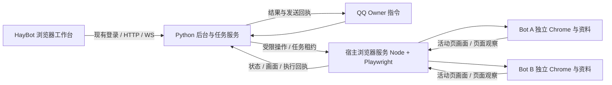

# 浏览器运行时迁移研究

> 2026-10-29 最新模式与平台范围见 [MODES.md](MODES.md)：固定无头，移除小红书专门支持。本文较早的 headed/实验性开关或最小化结论仅作历史记录。

研究日期：2026-10-28。本文保留研究阶段的事实与提案；2026-10-29 已实现独立原型并进行本机实验，最新结果见 [PROTOTYPE.md](PROTOTYPE.md)。本文中“本轮”“尚未实现”等表述指研究时状态。

2026-10-29 补充：仅支持 Google Chrome；进入浏览器运行时页面自动检测环境，缺失时提醒安装，安装入口固定为 `https://www.google.cn/chrome/`。取代此前“进入后直接自动安装”的流程；仍保留用户主动触发的辅助安装作为实现候选。

2026-10-29 后续产品调整：默认改为普通模式 `headless: false`，允许显示窗口和 Dock/任务栏图标；无头模式作为需明确风险确认的实验性选项。两种模式均保留实时查看与接管。下文“日常必须隐藏”等条目为早期研究要求，由此调整取代；实际行为见运行时 README。

安卓基线：`feature/android-runtime`，提交 `5c864e1`，已推送 GitHub。
浏览器工作分支：`feature/browser-runtime`，从上述基线继续。

## 1. 目标与本轮边界

将需要外部安卓运行时的操作，迁移为用户电脑上的独立浏览器进程。Bot 拥有独立登录资料，在 HayBot 内查看网页画面、接管操作、提交任务。日常运行不显示浏览器窗口，不在任务栏或 Dock 出现独立入口。

本轮只检查源码、读取本机软件元数据、查阅官方资料并制定方案。没有启动新的 Chrome 实例，没有读取个人 Chrome 资料，没有登录平台、发布内容、停用安卓或重新部署 8080。

“浏览器工作台可运行”“网站可以播放视频”“Bot 理解了视频”“评论/@ 成功”“账号可持续使用”分别验收，不互相代替。

## 2. 已确认的本机与项目情况

以下是本机只读检查结果，不是产品支持范围的承诺。

| 项目 | 观察结果 | 对方案的影响 |
| --- | --- | --- |
| 当前宿主 | macOS / arm64 | 先在本机验证 macOS，Windows 验收另列 |
| 已安装 Chrome | `/Applications/Google Chrome.app`，Info.plist 显示 `156.0.8078.73` | 有现成浏览器程序；实际启动版本和协议能力待实验确认 |
| 已安装 Node | `v22.14.0` | 可作为 Node 运行时原型候选，依赖兼容性仍需验证 |
| Python | 默认 3.9，另有 `/opt/homebrew/bin/python3.12` | 不改变用户默认 Python；Python 实现也可选独立 3.12 环境 |
| Playwright | 当前项目 frontend 和默认 Python 均未安装 | 不能把本次文档研究描述为已经运行成功 |
| 产品部署 | `compose.yaml`：Python 后台在容器内，8080 映射到 8000 | 本机 Chrome 应由宿主服务管理，容器通过受控接口访问 |
| 浏览器执行器 | 当前源码中未找到 | 需要新增，不能只重命名“安卓”页面 |

源码承接点：

| 现有代码 | 可承接部分 | 必须重做或检查的部分 |
| --- | --- | --- |
| `backend/app/android.py` | 任务记录、预算、取消/继续、模型诊断、来源检查 | 设备网关、观察格式、操作、运行循环中的安卓假设 |
| `backend/app/android_qq.py` / `android_voice.py` | QQ 请求来源、Owner 校验、结果回传及发送状态 | 自然语言识别中的手机语义、命令入口与浏览器任务上下文 |
| `backend/app/android_companion.py` | 用户填写的兴趣、公开人格、平台权限、互动日志 | Android XML、包名、坐标、蓝色 @ 判断；数据模型和 UI 识别目前耦合 |
| `backend/app/android_intent.py` / `android_progress.py` | 谁的兴趣、是否要链接、真实浏览进展等语义 | “打开浏览器是绕路”等安卓专属规则，必须限制在旧执行器 |
| `backend/app/android_live.py` | 登录会话、同源检查、Bot 生命周期、服务端 WS 中继 | scrcpy 的二进制协议和安卓设备路径 |
| `android_runtime/service.py` | 宿主服务、租约、人工接管、登录期间隔离的设计 | Docker/redroid、ADB、scrcpy、安装 App 和设备生命周期 |
| `frontend/src/AndroidPage.jsx` / `AndroidViewer.jsx` | 工作台布局、任务列表、放大和接管的交互 | 浏览器地址、标签页、窗口尺寸、实时帧和输入映射 |
| `backend/app/main.py` / `registry.py` / `bot.py` | 服务挂载和 Bot 生命周期入口 | 当前显式绑定 android；归档、停止和模型引用校验也要接入新执行器 |

## 3. 官方资料确认的能力与限制

### 独立进程与持久化资料

Chrome 的统一 Headless 模式不显示平台窗口，适合作为默认候选。[S1] 这份说明不等于 macOS Dock/应用切换器和 Windows 任务栏均已实测无入口；这些是下一阶段硬验收项。

Playwright 的 `launchPersistentContext` 支持独立资料目录，保留 Cookie 与本地存储，并且同一目录不能同时启动多个实例。[S2] Chrome 136 起对默认个人资料目录的远程调试有额外限制。[S3] 因此使用本机 Chrome 程序，但每个 Bot 分配自己的资料目录，由 Owner 单独登录。

优先使用 Playwright 自行启动和管理的进程，不从用户已打开的 Chrome 查找调试端口。资料目录以 Bot ID 关联，避免重命名改变目录。停止进程保留资料；删除资料是单独操作。

### 浏览器选择与本地服务语言

产品仅支持官方 Google Chrome 稳定版。不提供浏览器类型选择，不回退到 Chromium、Edge、Firefox、WebKit 或 Chrome Headless Shell。Playwright 中的 `chromium` 是驱动入口，实际启动必须指定 `channel: 'chrome'`；如果平台安装方式需要明确路径，必须验证为官方 Chrome 稳定版后使用。

首选实验组合：宿主 Node 服务 + Playwright + 本机 `chrome` channel + 持久化独立目录 + `headless: true`。

理由是 Playwright 已提供语义定位、持久化上下文和画面帧接口；使用官方 Chrome 也便于验证视频编码兼容性。官方明确提示，Chromium 与 Chrome 的媒体编解码器并不完全一致。[S4] 这不是对三个目标网站播放成功的保证。

使用 `chrome` channel，避免第一步下载覆盖用户的 Chrome。研究时 npm 官方包元数据返回 Playwright `1.64.1`，其 engines 声明 `node >=20`；当前文档的推荐要求是最新 22.x、24.x 或 26.x。[S5][S10] 原型候选锁定 `1.64.1`，实际兼容与启动实验通过后再将其确认为项目依赖。本机 22.14.0 符合包声明，但不等于已经完成兼容性验收。

Python 3.12 + Playwright 可作为同一架构的替代实现，但第一阶段不同时维护两套。暂不引入 Electron，也不为此次迁移新增桌面客户端。

### Chrome 启动前置条件（2026-10-29 用户要求）

进入浏览器运行时页面即自动检查环境，每次启动会话或提交任务前再次校验前置条件；不把启动时“找不到可执行文件”留给任务模型处理。检测对象是 HayBot 执行器所在的宿主机，不是打开管理网页的客户端，也不是后台 Docker 容器。

1. 检测宿主操作系统、CPU 架构与官方支持范围，发现并验证已安装 Chrome 的产品身份、稳定版渠道、版本和可执行文件。已有可用 Chrome 直接复用程序，Bot 仍使用独立资料目录。
2. 未安装时显示“未检测到 Google Chrome”，提供“前往安装”和“重新检测”。“前往安装”的固定入口为用户指定的 `https://www.google.cn/chrome/`（Google 中国 Chrome 官网，[S12]），不自动打开网页，不在页面挂载时静默安装。点击后引导安装，完成后重新检测；未通过前不进入可操作工作台。后续若提供辅助自动安装，必须由用户主动点击触发，并通过该官方渠道按平台和架构取得安装包、验证发布者签名或包签名，展示真实进度；不硬编码未经验证的下载包地址。
3. 安装优先采用可行的当前用户安装方式；需要系统权限时使用系统原生授权流程。拒绝授权、网络失败、磁盘不足、安装包校验失败、版本不兼容或官方不支持当前平台时，明确停在对应前置条件，提供重试/修复说明，不能继续提交浏览器任务或改用其他浏览器。
4. 安装后重新发现并校验 Chrome，再以独立临时资料做隐藏启动、协议握手和正常退出的最小验证；全部成功后才标记 `ready`，进入会话与任务阶段。仅检测到文件或安装器返回成功不算完成。
5. 多 Bot/多个页面共用宿主级检测与可选安装锁；相同条件下重复进入页面/setup/start 幂等，不重启已运行的 Bot 浏览器。检测不得因页面轮询反复创建验证进程，启动握手在首次准备、环境变化或显式重试时执行，已有有效运行连接可复用。Chrome 运行中不进行覆盖安装，不为每个 Bot 重复下载或安装。已有版本损坏/不兼容与“完全未安装”分开处理，先明确诊断，不自动降级或覆盖可用安装。
6. 不更改默认浏览器，不导入用户日常 Chrome 的 Cookie/密码，不在卸载 HayBot 时顺带卸载用户 Chrome。安装阶段可能出现的系统授权与安装器 UI 独立记录；日常 Bot 浏览器隐藏运行的要求仍然成立，安装完成后不遗留欢迎窗口。

官方安装说明提供各平台支持与安装流程。[S11] Playwright 不会默认安装官方 Chrome，且其浏览器安装命令可能覆盖全局安装位置，[S4] 因此不能在每次启动时无条件执行 `playwright install chrome`。具体下载地址、签名验证、用户级安装可行性及系统授权行为进入原型验证，未实测前不承诺所有平台均可全程静默安装。

页面流程：`检测中 → 待安装 / 待修复 / 环境就绪`。紧凑展示系统与架构、宿主运行时连接、Chrome、运行依赖、工作目录权限与启动连接验证的实际结果；区分“失败”和“尚未检查”。宿主服务离线时提示连接/启动运行时，不误报为 Chrome 未安装。阻断项配具体处理入口，“重新检测”不需要刷新整个管理平台。失败时保留任务记录与设置入口，限制依赖环境的启动、接管和任务操作；后端也必须校验，不能只禁用按钮。环境就绪不等于已登录平台或已启动 Bot 会话。

本次更新的是产品约束和验收标准，环境检测页与辅助安装器尚未实现；当前开发机已装有 Chrome，不触发安装或重装。

### 实时查看

新版官方 API `page.screencast.start({ onFrame })` 自 v1.59 提供 JPEG 帧回调，包括时间戳和 viewport 尺寸。[S6] 优先验证该接口，再考虑 Chromium CDP 的 `Page.startScreencast` 兼容后备。[S7]

不沿用现有 H.264/scrcpy 协议。拟定由宿主采集活动标签页画面，后台鉴权转发，前端解码显示。每个浏览器会话共享一份活动页采集源，多观察者复用，不为每个查看窗口新建采集任务。

协议至少携带 `session_id`、`tab_id`、`generation`、帧编号、采集时间、viewport CSS 尺寸、图片像素尺寸与编码。只保留最近帧，慢客户端不累积历史帧。接管输入绑定活动标签和 generation，缩放后映射到 CSS 坐标。

画面回调不是音频通道；该 API 中的 fps 参数描述录制文件，不应直接作为实时回调帧率承诺。[S6] 第一阶段测量延迟、CPU、帧流量和页面变化后的更新，不宣称等同本地直接观看视频。

### 网页观察和操作

Playwright 支持读取 ARIA 快照来获得可访问元素及文本。[S8] 在此基础上设计“文字/语义结构 + 截图”的观察：模型选择可见目标，执行器解析为有限的点击、输入、滚动、导航和标签操作。

模型不接收任意浏览器 JavaScript 或宿主命令执行权。观察结果带版本；导航、新标签、页面重载后旧目标失效。iframe、虚拟列表、Canvas、同名按钮和页面弹窗必须纳入原型，而不是假设网页结构始终可完整读取。

第一版保留坐标操作作为复杂控件的后备，坐标必须来自最近一次对应标签的实际画面。网页内容和引用是观察材料，不成为新任务或权限来源。

### 视频、字幕与声音

分别记录：页面已打开、视频已加载、播放时间推进、字幕是否可读、是否取得声音、理解依据。验证 HTML 媒体状态与可见字幕可行性；跨域 iframe、Canvas 和不同播放器需单独处理。

本轮没有选定音频采集通道。实时 JPEG 帧不能证明 Bot 听见声音；录屏文件、实时监看、字幕理解、音频转写也不是同一功能。Playwright 官方启动文档还展示了从默认参数中过滤 `--mute-audio` 的方式，[S2] 因此默认是否静音必须检查；解除静音也不等于已经取得可供模型使用的音频。缺少依据时任务结果明确说明依据，不能推测对白。

### 备用运行形态

如本机 Headless 无法同时满足隐藏和站点兼容性，再研究 Linux 虚拟显示中的完整官方 Chrome；仍受 Chrome 唯一浏览器前置条件约束，无官方兼容发行版时不得用 Chromium 替代。Playwright 官方提供 Xvfb 的有界面运行方式。[S9] 该方案增加部署复杂度，编码与播放仍要验收，不在研究阶段默认引入，更不把它作为绕过平台限制的保证。

## 4. 拟定架构

这是架构提案，不是已经存在的实现。宿主接口不直接交给网页前端或模型，CDP/Playwright 管理端点不作为产品公开接口。容器到宿主的连通方式单独验证：不能假设 `host.docker.internal` 一定能访问任意 loopback 监听，也不能为图省事直接暴露未鉴权调试端口。

可先用本地受控接口验证，再决定 loopback 转接、宿主代理或反向连接。沿用现有租约/登录隔离思路，但 browser token、端口、进程、数据库和目录与安卓分离。

拟定新增模块：

- `browser_runtime/`：进程、资料锁、标签、有限操作、画面采集、宿主服务。
- `scripts/browser_runtime.*`：独立 setup/start/status/stop 入口，具体语言在原型后锁定。
- `backend/app/browser*.py`：配置、任务、鉴权路由、QQ 桥接及状态回传。
- 前端浏览器工作台及通用画面容器；以改造现有页面承接为目标，原型阶段使用开发入口。
- 私有 `.browser-runtime/`：资料、日志、运行时令牌、下载和截图；实现前加入忽略清单，不提交 Git。

## 5. 必须延续的产品行为

- 手机使用权限迁移为浏览器使用权限，仍由 Owner 授权；普通群友不能触发实际操作，也不能读取私人页面与任务结果。
- 登录/验证码期间停止自动化观察和任务模型调用；Owner 可在工作台完成登录，结束后重新观察再继续。
- 角色兴趣由用户填写，不能从人格推导；本次明确看角色喜欢的内容时，分享/@ 的通知对象不改变选片依据。
- 自主浏览不设“看到两个候选即完成”的固定门槛。由目标、浏览进展、时间与真实内容决定计划。
- B站“分享给我”默认延续真实 @ 的用户约定；明确要求链接时才收集链接。这个语义与“允许浏览器导航”不能冲突。
- 评论去重沿用“平台 + 已核实发表账号 + 内容 ID”；B站优先 BV。账号未核实不可默默退回 Bot 范围并声称跨 Bot 去重已完成。
- 兴趣/公开人格可迁移，评论与 @ 授权需要在新站点会话中验证绑定；不能将旧 App 登录状态当成网页登录成功。
- 发布、评论、发送等动作出现断线时记录结果未知，观察后核对，不自动重试写操作。
- 任务完成与 QQ 消息发送成功分开核验，两种 QQ 接入均覆盖。
- 原“回桌面/清后台”迁移为关闭任务临时标签、暂停任务媒体、释放操作租约；保留账号资料和用户明确要求继续的页面。

## 6. 状态、接管与故障处理

建议会话状态：stopped / starting / ready / owner_login / owner_control / disconnected / failed。任务状态与会话状态分开，不能因最后一张截图还在显示就标记浏览器在线。

一个资料目录同一时刻只有一个写入进程。多个观察者可观看，操作只有一个有效持有者。接管递增 generation 并撤销旧任务输入；退出接管不自动恢复旧动作。停止/归档 Bot 时先撤销浏览器任务与租约，再关闭对应进程。

故障后区分：进程退出、标签关闭、导航失败、播放器缓冲、登录过期、采集断线。页面缓冲不能直接导致换内容；观看进展不能仅以固定等待时间计数。

## 7. 阶段划分

| 阶段 | 交付 | 进入下一阶段的依据 |
| --- | --- | --- |
| 1. 研究（本轮） | 本文、源码映射、原型验收清单 | 事实/提案/待验证项清晰分开，安卓基线已保存并推送 |
| 2. 本机独立原型 | 宿主环境/Chrome 检测、官网安装引导 + 临时资料 + 隐藏 Chrome + 本地测试网页 + 帧回调 + 操作 | 安装前置条件、隐藏、持久化、标签、画面/输入、崩溃回收和 Docker 通路实验完成 |
| 3. 工作台与权限 | 页面进入自动检测、安装/修复/重检、后台鉴权中继、实时查看、放大、接管、登录隔离 | 环境检测页面与后端前置校验通过，同源/归属/租约和 stale 输入测试通过，Owner 可完整接管 |
| 4. Bot 任务接入 | 观察/决策、任务记录、QQ 调用和回传 | 两个 Bot/两种 QQ 接入不串号、不漏回传，陌生页面可探索 |
| 5. 平台逐项验收 | B站，再抖音/小红书的能力矩阵 | 登录、搜索/推荐、播放、身份、链接、评论/@ 分别给出证据 |
| 6. 替换与部署 | 入口切换、设置迁移、安卓退役方案 | 数据可恢复，浏览器主链路通过验收后再退出旧运行时 |

下一步是阶段 2 的独立原型，具体清单见 `ACCEPTANCE.md`。本轮不将正式安卓页面直接替换为未经实测的浏览器页面。

## 官方来源

本节记录 2026-10-28 查阅的一手资料；上线实现前以选定依赖版本再核验一次。来源支持 API 能力，不证明目标平台不会触发风控。

- [S1 Chrome Headless](https://developer.chrome.com/docs/automation-and-testing/headless)：统一无窗口模式。
- [S2 Playwright BrowserType](https://playwright.dev/docs/api/class-browsertype#browser-type-launch-persistent-context)：资料目录、持久化上下文与启动限制。
- [S3 Chrome remote debugging changes](https://developer.chrome.com/blog/remote-debugging-port)：Chrome 136 起默认资料目录限制。
- [S4 Playwright browsers](https://playwright.dev/docs/browsers)：官方 Chrome channel、Headless 差异与媒体编码。
- [S5 Playwright installation](https://playwright.dev/docs/intro#system-requirements)：当前文档系统要求。
- [S6 Playwright Screencast](https://playwright.dev/docs/api/class-screencast#screencast-start)：JPEG 帧、viewport、录制选项和版本信息。
- [S7 Chrome DevTools Protocol Page](https://chromedevtools.github.io/devtools-protocol/tot/Page/)：协议候选；tip-of-tree 需实际浏览器能力探测。
- [S8 Playwright ARIA snapshots](https://playwright.dev/docs/aria-snapshots)：结构化页面观察依据。
- [S9 Playwright CI](https://playwright.dev/docs/ci#running-headed)：Linux Xvfb 备用形态。
- [S10 npm Playwright 官方包元数据](https://registry.npmjs.org/playwright/latest)：本次读取返回 `1.64.1`、`node >=20`；实现阶段使用固定版本，不依赖浮动 latest。
- [S11 Google Chrome 官方安装说明](https://support.google.com/chrome/answer/95346)：2026-10-29 补查，按平台安装及系统要求。
- [S12 Google Chrome 中国官网](https://www.google.cn/chrome/)：2026-10-29 核实，用户指定的安装入口；页面提供 Chrome 安装说明与平台支持指引。
